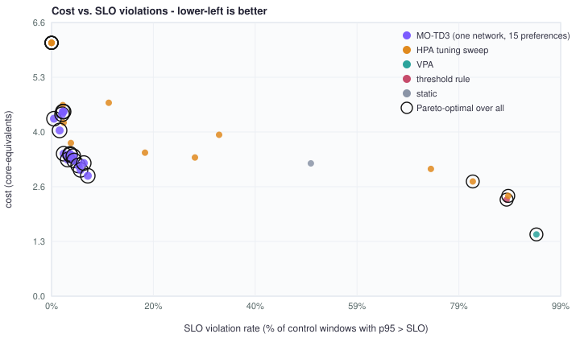
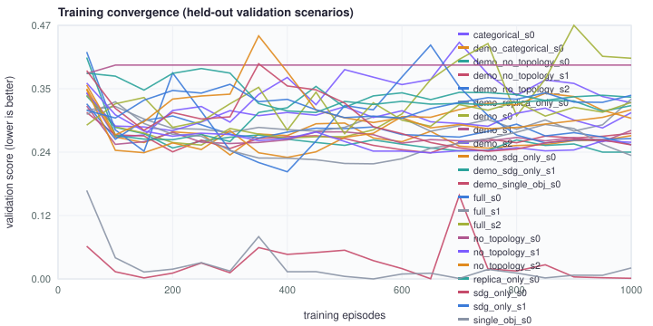
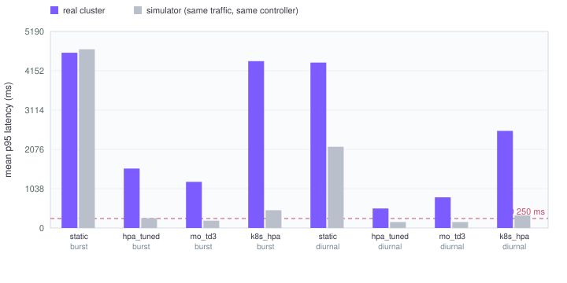

# Topology-Aware Multi-Objective DRL for Adaptive Kubernetes Microservice Orchestration

**Project J26-SE-315 · IT4010 Research Project · SLIIT**

A Kubernetes autoscaler that reads the *service dependency graph* and the *live latency graph*
of a microservice application and, **per service**, decides how many pods to run *and* how much
CPU and memory each pod gets. It is a **Multi-Objective Twin-Delayed DDPG (MO-TD3)** agent with a
**hybrid action space** (replica delta −3…+3, continuous CPU and memory), a **2-layer GCN** encoder
(128 hidden units, 64-d embedding) and a **preference-conditioned** policy, trained on a simulator
that is *fitted to measurements from a real cluster* and validated back against that cluster.

This repository implements the four sub-components of the Topic Assessment Form
(environment modelling → topology feature extraction → multi-objective DRL agent → reward
engineering & evaluation). [`docs/TAF_TRACEABILITY.md`](docs/TAF_TRACEABILITY.md) maps every
requirement of the form to code, tests and status.

```
 Prometheus ─┐                      ┌── SDG (call frequency)  ─► GCN ─┐
 Jaeger ─────┼─► state builder ─────┤                                 ├─► 64-d embedding + critical path
 K8s API ────┘   (18 features/svc)  └── EHG (latency p95/edge) ─► GCN ─┘            │
      ▲                                                                              ▼
      │   safety guard (bounds · memory floor · cooldowns · budget · breaker) ◄── MO-TD3 actor (shared per service,
      │                                                                          conditioned on preference w)
      └── scale / resize the Deployments ◄── per service: Δreplicas ∈ {−3..+3}, CPU, memory
                         reward vector  (SLO, cost, balance)  ─►  twin critics, one Q per objective
```

---

## Running it on a real application and on any cluster

Beyond the 6-service demo app, the agent has been run against the real **Train-Ticket** benchmark (46 Java/Spring Deployments, 33 running, on a
separate machine; the controller on a laptop reaches it over SSH tunnels). **Start with [`docs/INTERVIEW_DEMO.md`](docs/INTERVIEW_DEMO.md)** (the demo script) and
[`docs/TRAINTICKET.md`](docs/TRAINTICKET.md) (setup, measurements, results, limits).

* **Point it at any cluster:** `bash scripts/20_autoscale_any_cluster.sh --namespace <ns> --prometheus <url> --jaeger <url>`. It inspects the cluster and derives the entry service
  (the root of most traces), the controlled services, the action bounds (current limits and measured memory), the replica cap (node headroom), the pod start-up time (measured from
  real pods) and the metric window (4x the scrape interval), and starts in shadow mode. Needs Prometheus with cAdvisor + kube-state-metrics and OpenTelemetry traces in Jaeger.
* **The dependency graph is learned live** from traces (`topology_intel/live_topology.py`): nothing is declared except the entry service; edges decay and expire.
* **The critical path is checked against real requests:** each request's end-to-end time is attributed to services by replaying its trace backwards (as in Uber's CRISP);
  on 253 real requests the agent's path explains 80 % of the downstream time (a random chain 48 %), and a CRISP-style set per request type 96 % held out
  (`python -m src.evaluation.critical_path_eval`). The dashboard shows the proof and the per-service critical shares live.
* **Real actions, with extra safety:** a whitelist of controllable services, replica-only mode, a node-memory check before every scale-up, a stabilisation window after a
  scale-up. Verified live: the agent scaled a staged CPU bottleneck (`ts-order-service`) 1 -> 2 -> 1 in two runs and the cluster was restored to its saved baseline.
* **Many services (simulation):** a decision takes 0.4-0.9 ms from 8 to 100 services; one API call reads every Deployment per step.
* **Honest result:** on Train-Ticket the agent is on par with a tuned HPA (with room to scale: fewer SLO violations, 14 % higher cost; with the node's 2-replica cap every controller is
  capacity-limited). The value is the critical-path analysis, the multi-objective control and the safety layer, not a clear win over HPA.
* **If the network fails:** `python -m src.dashboard.server --mode replay --replay autoscaler/results/replays/trainticket_run.jsonl` plays back a recorded live run, labelled as a replay.

* **A model that scales replicas AND CPU, trained and run live with the data stored:** `mo_td3_trainticket_cpu` (fine-tuned from `mo_td3_large`, memory locked) raised the staged bottleneck `ts-order-service` from 1 pod / 300m to 2 pods / 1 core on the real cluster,
  the gateway p95 fell from about 3.3 s to 0.9 s, and the resize cost about 80 s of that service (2.0 % of calls failed). It keeps that service at maximum at any load (no scale-down), so it is not a load-following controller. Every step of the training
  and of the live runs is in the database. Commands and numbers: [`docs/RUN_LOG_TRAINTICKET_CPU.md`](docs/RUN_LOG_TRAINTICKET_CPU.md); all other commands: [`docs/USER_GUIDE.md`](docs/USER_GUIDE.md); the demo script: [`docs/FULL_DEMO.md`](docs/FULL_DEMO.md).
* **History in PostgreSQL (opt-in):** with `AUTOSCALER_DATABASE_URL` set (`bash scripts/22_db_up.sh`) the agent stores its actions (proposed / approved / applied, with the reason a
  scale-up was blocked), per-service metrics (24 h), the critical-path analysis, SLO-violation episodes and events (90 days), separately for every cluster it is plugged into; the control
  room has a History panel and `python -m src.persistence.export` writes CSVs. Writing never blocks or fails the control loop. See [`docs/PERSISTENCE.md`](docs/PERSISTENCE.md).

---

## Results

Everything in this section is **generated from the committed result files** by
`python -m src.evaluation.report` (CI fails if the README drifts from the data). Lower is better
everywhere. *score* is the preference-weighted penalty the agent itself minimises.

### Controller comparison and ablation (simulator, calibrated on a real cluster)

<!-- BEGIN:results -->
24 matched-seed episodes (burst / diurnal / ramp-up / normal), default preference (SLO, cost, balance) = (0.5, 0.35, 0.15). Lower is better everywhere; best per column in bold.
The tuned HPA is the best (CPU size, utilisation target) found on a held-out seed range: **0.5 cores, 50% target**.

**6-service application (the one deployed on the cluster and calibrated against it):**

| controller | p95 ms | SLO violations | cost | adapt s | score |
|---|---|---|---|---|---|
| static (no scaling) | 2320 | 51.0% | 3.19 | 150 | 0.398 |
| threshold rule (80 % / 30 %) | 611 | 88.0% | 2.33 | 141 | 0.407 |
| HPA (default 60 % target, 0.25-core pods) | 420 | 81.1% | 2.78 | 134 | 0.351 |
| **HPA, tuned** (CPU size × target, held-out grid) | 199 | 4.7% | 3.69 | 16 | 0.230 |
| VPA (right-sizing only) | 16845 | 94.0% | **1.49** | 205 | 0.559 |
| **MO-TD3 full** (dual-graph GCN, hybrid actions, pure RL) | 168 | 2.9% | 3.57 | 9 | **0.219** |
| MO-TD3, SDG branch only | 185 | 6.1% | 4.14 | 20 | 0.259 |
| MO-TD3, no topology (no GCN) | 217 | 16.7% | 3.92 | 48 | 0.276 |
| MO-TD3, single objective (latency only) | 121 | **0.0%** | 5.71 | **0** | 0.334 |
| MO-TD3, replicas only (no CPU/mem actions) | 226 | 16.5% | 4.38 | 65 | 0.296 |
| MO-TD3, categorical replica head (straight-through) | 133 | 0.9% | 4.36 | 3 | 0.259 |
| MO-TD3 full **+ HPA demonstrations** (TD3+BC) | 191 | 8.7% | 3.95 | 27 | 0.252 |
|   + demos, SDG branch only | 212 | 16.8% | 3.40 | 45 | 0.235 |
|   + demos, no topology | 179 | 5.2% | 3.79 | 13 | 0.238 |
|   + demos, single objective | **119** | **0.0%** | 5.82 | **0** | 0.343 |
|   + demos, replicas only | 238 | 21.0% | 3.81 | 46 | 0.267 |
|   + demos, categorical head | 156 | 2.8% | 3.93 | 8 | 0.238 |

Learned arms with several training seeds are shown as the **mean over seeds** (**MO-TD3 full** (dual-graph GCN, hybrid actions, pure RL): 3, MO-TD3, SDG branch only: 2, MO-TD3, no topology (no GCN): 3, MO-TD3 full **+ HPA demonstrations** (TD3+BC): 3,   + demos, SDG branch only: 2,   + demos, no topology: 3).

**Across training seeds** (mean ± std; one RL run is an anecdote):

| arm | seeds | p95 ms | SLO violations | cost | score |
|---|---|---|---|---|---|
| **MO-TD3 full** (dual-graph GCN, hybrid actions, pure RL) | 3 | 168 ± 11 | 2.9% ± 0.7% | 3.57 ± 0.42 | 0.219 ± 0.026 |
| MO-TD3, SDG branch only | 2 | 185 ± 55 | 6.1% ± 4.5% | 4.14 ± 0.61 | 0.259 ± 0.025 |
| MO-TD3, no topology (no GCN) | 3 | 217 ± 95 | 16.7% ± 21.1% | 3.92 ± 0.41 | 0.276 ± 0.045 |
| MO-TD3 full **+ HPA demonstrations** (TD3+BC) | 3 | 191 ± 16 | 8.7% ± 2.4% | 3.95 ± 0.42 | 0.252 ± 0.019 |
|   + demos, SDG branch only | 2 | 212 ± 21 | 16.8% ± 8.9% | 3.40 ± 0.01 | 0.235 ± 0.017 |
|   + demos, no topology | 3 | 179 ± 16 | 5.2% ± 1.2% | 3.79 ± 0.11 | 0.238 ± 0.004 |

**14-service application with Train-Ticket's call structure - never seen in training (larger and deeper than any training topology):**

| controller | p95 ms | SLO violations | cost | adapt s | score |
|---|---|---|---|---|---|
| static (no scaling) | 7357 | 90.1% | 7.45 | 190 | 0.501 |
| threshold rule (80 % / 30 %) | 1034 | 85.9% | 5.78 | 138 | 0.426 |
| HPA (default 60 % target, 0.25-core pods) | 673 | 82.6% | 6.69 | 135 | 0.359 |
| **HPA, tuned** (CPU size × target, held-out grid) | 277 | 1.7% | 9.22 | 4 | 0.245 |
| VPA (right-sizing only) | 33260 | 96.5% | **3.53** | 205 | 0.584 |
| **MO-TD3 full** (dual-graph GCN, hybrid actions, pure RL) | 280 | 6.3% | 8.56 | 16 | **0.238** |
| MO-TD3, SDG branch only | 305 | 10.7% | 10.06 | 22 | 0.296 |
| MO-TD3, no topology (no GCN) | 352 | 14.0% | 10.30 | 46 | 0.296 |
| MO-TD3, single objective (latency only) | **172** | **0.5%** | 13.60 | **0** | 0.343 |
| MO-TD3, replicas only (no CPU/mem actions) | 352 | 21.5% | 10.45 | 72 | 0.308 |
| MO-TD3, categorical replica head (straight-through) | 435 | 5.1% | 10.39 | 18 | 0.291 |
| MO-TD3 full **+ HPA demonstrations** (TD3+BC) | 369 | 7.5% | 9.78 | 16 | 0.273 |
|   + demos, SDG branch only | 415 | 24.9% | 8.00 | 67 | 0.262 |
|   + demos, no topology | 359 | 12.1% | 9.20 | 24 | 0.270 |
|   + demos, single objective | 172 | 1.5% | 13.47 | 5 | 0.346 |
|   + demos, replicas only | 356 | 25.7% | 9.76 | 88 | 0.304 |
|   + demos, categorical head | 296 | 5.5% | 9.35 | 16 | 0.259 |

Learned arms with several training seeds are shown as the **mean over seeds** (**MO-TD3 full** (dual-graph GCN, hybrid actions, pure RL): 3, MO-TD3, SDG branch only: 2, MO-TD3, no topology (no GCN): 3, MO-TD3 full **+ HPA demonstrations** (TD3+BC): 3,   + demos, SDG branch only: 2,   + demos, no topology: 3).

**16 held-out random topologies** (same generator as training, disjoint seeds, 4-12 services, tiers 2-5, shared callees):

| controller | p95 ms | SLO violations | cost | adapt s | score |
|---|---|---|---|---|---|
| static (no scaling) | 6028 | 91.9% | 4.43 | 193 | 0.594 |
| threshold rule (80 % / 30 %) | 1007 | 93.7% | 3.36 | 175 | 0.501 |
| HPA (default 60 % target, 0.25-core pods) | 681 | 90.2% | 3.82 | 163 | 0.461 |
| **HPA, tuned** (CPU size × target, held-out grid) | 222 | 19.0% | 5.44 | 54 | 0.266 |
| VPA (right-sizing only) | 18170 | 98.3% | **2.18** | 204 | 0.590 |
| **MO-TD3 full** (dual-graph GCN, hybrid actions, pure RL) | 219 | 8.3% | 5.36 | 21 | **0.250** |
| MO-TD3, SDG branch only | 198 | 8.4% | 6.44 | 22 | 0.292 |
| MO-TD3, no topology (no GCN) | 262 | 21.9% | 5.99 | 57 | 0.312 |
| MO-TD3, single objective (latency only) | **164** | 7.7% | 7.74 | 19 | 0.343 |
| MO-TD3, replicas only (no CPU/mem actions) | 477 | 57.2% | 5.65 | 148 | 0.423 |
| MO-TD3, categorical replica head (straight-through) | 492 | 12.7% | 6.38 | 34 | 0.318 |
| MO-TD3 full **+ HPA demonstrations** (TD3+BC) | 235 | 19.3% | 5.67 | 49 | 0.285 |
|   + demos, SDG branch only | 239 | 19.4% | 5.41 | 46 | 0.273 |
|   + demos, no topology | 214 | 12.1% | 5.76 | 30 | 0.274 |
|   + demos, single objective | 244 | 10.0% | 7.90 | 36 | 0.369 |
|   + demos, replicas only | 497 | 59.6% | 5.31 | 151 | 0.418 |
|   + demos, categorical head | 195 | **5.5%** | 6.12 | **13** | 0.272 |

Learned arms with several training seeds are shown as the **mean over seeds** (static (no scaling): 16, threshold rule (80 % / 30 %): 16, HPA (default 60 % target, 0.25-core pods): 16, **HPA, tuned** (CPU size × target, held-out grid): 16, VPA (right-sizing only): 16, **MO-TD3 full** (dual-graph GCN, hybrid actions, pure RL): 3, MO-TD3, SDG branch only: 2, MO-TD3, no topology (no GCN): 3, MO-TD3, single objective (latency only): 16, MO-TD3, replicas only (no CPU/mem actions): 16, MO-TD3, categorical replica head (straight-through): 16, MO-TD3 full **+ HPA demonstrations** (TD3+BC): 3,   + demos, SDG branch only: 2,   + demos, no topology: 3,   + demos, single objective: 16,   + demos, replicas only: 16,   + demos, categorical head: 16).
<!-- END:results -->

### One network, the whole trade-off curve (Pareto analysis)

<!-- BEGIN:pareto -->
One MO-TD3 network evaluated at 15 preferences vs. 15 HPA configurations (CPU size × target), plus static / VPA / threshold. Non-dominated points over all controllers on (SLO-violation rate, p95, cost):

| point | p95 ms | SLO violations | cost | Pareto-optimal |
|---|---|---|---|---|
| vpa | 16801 | 94.1% | 1.49 | yes |
| threshold | 585 | 88.3% | 2.32 | yes |
| hpa(cpu=0.25,target=0.7) | 545 | 88.6% | 2.41 | yes |
| hpa(cpu=0.25,target=0.6) | 409 | 81.7% | 2.76 | yes |
| mo_td3_full@w=(0.00,1.00,0.00) | 201 | 7.0% | 2.90 | yes |
| mo_td3_full@w=(0.00,0.75,0.25) | 189 | 5.6% | 3.04 | yes |
| mo_td3_full@w=(0.25,0.75,0.00) | 179 | 5.2% | 3.15 | yes |
| mo_td3_full@w=(0.00,0.50,0.50) | 175 | 6.2% | 3.20 | yes |
| mo_td3_full@w=(0.25,0.50,0.25) | 168 | 4.4% | 3.27 | yes |
| mo_td3_full@w=(0.50,0.50,0.00) | 165 | 3.1% | 3.29 | yes |
| mo_td3_full@w=(0.00,0.25,0.75) | 164 | 4.2% | 3.37 | yes |
| mo_td3_full@w=(0.25,0.25,0.50) | 162 | 3.6% | 3.40 | yes |
| mo_td3_full@w=(0.50,0.25,0.25) | 161 | 3.6% | 3.42 | yes |
| mo_td3_full@w=(0.75,0.25,0.00) | 159 | 2.3% | 3.43 | yes |
| mo_td3_full@w=(0.00,0.00,1.00) | 143 | 1.6% | 3.99 | yes |
| mo_td3_full@w=(0.25,0.00,0.75) | 138 | 0.5% | 4.27 | yes |
| mo_td3_full@w=(0.50,0.00,0.50) | 137 | 2.0% | 4.38 | yes |
| mo_td3_full@w=(0.75,0.00,0.25) | 136 | 2.3% | 4.44 | yes |
| mo_td3_full@w=(1.00,0.00,0.00) | 136 | 2.2% | 4.44 | yes |
| hpa(cpu=1.0,target=0.3) | 117 | 0.0% | 6.10 | yes |
| hpa(cpu=1.0,target=0.4) | 117 | 0.0% | 6.10 | yes |
| hpa(cpu=1.0,target=0.5) | 117 | 0.0% | 6.10 | yes |
| hpa(cpu=1.0,target=0.6) | 117 | 0.0% | 6.10 | yes |
| hpa(cpu=1.0,target=0.7) | 117 | 0.0% | 6.10 | yes |

Hypervolume in (violation rate, cost/budget), larger is better: **MO-TD3 0.448** ± 0.102 over 3 training seeds (seed 0: 0.531, seed 1: 0.508, seed 2: 0.305) vs. **HPA tuning sweep 0.449**. The plotted/listed MO-TD3 points are from the *median* seed (1), not the best (15 of 15 of its points are Pareto-optimal over all controllers).
<!-- END:pareto -->





### Real-cluster validation

The simulator is only worth anything if it predicts the real system. Two independent checks:

**1. The service model, fitted to measurements** (`calibration/`, `scripts/13_calibrate.sh`): a single
replica of the service on a real kind cluster, open-loop Poisson load from an in-cluster pod, at four CPU limits.

<!-- BEGIN:calibration -->
| CPU limit | measured saturation (req/s) | model (req/s) |
|---|---|---|
| 0.10 core | 4.9 | 5.1 |
| 0.25 core | 14.7 | 14.8 |
| 0.50 core | 29.7 | 31.0 |
| 1.00 core | 61.8 | 63.4 |

Latency model vs. 36 measurements: steady region (n=31) mean-latency MAPE 24 %, p95 MAPE 27 %, 97% of p95 predictions within 2×; near saturation (n=5, held out) p95 MAPE 52 %.
<!-- END:calibration -->

**2. Whole closed-loop controllers on the real cluster** (`scripts/15_live_experiment.sh`), each paired with the
identical simulated run:

<!-- BEGIN:live -->
Real kind cluster, 40 control steps of 10 s per run, client-observed latency from an in-cluster open-loop load generator, SLO = 250 ms p95. Each real run is paired with the identical simulated run.

| pattern | controller | live p95 ms | sim p95 ms | live SLO viol. | sim SLO viol. | live cost | sim cost |
|---|---|---|---|---|---|---|---|
| burst | static (no scaling) | 4627 | 4718 | 97.5% | 42.5% | 3.19 | 3.19 |
| burst | **HPA, tuned** (CPU size × target, held-out grid) | 1569 | 260 | 42.5% | 5.0% | 4.22 | 4.18 |
| burst | MO-TD3 (pure RL, seed 0) | 1218 | 192 | 50.0% | 5.0% | 3.15 | 3.54 |
| burst | real Kubernetes HPA (60 % target, metrics-server) | 4406 | 469 | 100.0% | 75.0% | 2.50 | 3.48 |
| diurnal | static (no scaling) | 4367 | 2145 | 72.5% | 62.5% | 3.19 | 3.19 |
| diurnal | **HPA, tuned** (CPU size × target, held-out grid) | 515 | 158 | 47.5% | 0.0% | 3.98 | 3.92 |
| diurnal | MO-TD3 (pure RL, seed 0) | 809 | 158 | 77.5% | 0.0% | 2.97 | 3.45 |
| diurnal | real Kubernetes HPA (60 % target, metrics-server) | 2563 | 331 | 75.0% | 57.5% | 3.10 | 3.07 |
<!-- END:live -->



**What the live runs show - and the gap they expose.** One run per cell (single seed, no confidence interval), SLO = 250 ms p95.
* The pipeline works end to end on a real cluster: the learned agent and every baseline drove the real Kubernetes API (scaling and
  resizing Deployments) from real Prometheus signals, and costs agree with the simulator within ~15 %. Where nothing adapts (static, burst) the
  simulator reproduces the real p95 almost exactly (4718 vs 4627 ms).
* **Closed-loop behaviour is much worse on the real cluster than simulated.** Every autoscaler shows 3-8× higher p95 and far more SLO
  violations than its simulated twin (e.g. tuned HPA, burst: 1569 vs 260 ms; MO-TD3, diurnal: 809 vs 158 ms). The real traces show
  why: a 3× step in load hits services that had just been scaled down to one pod, the backlog grows to 9 s with client timeouts, and recovery takes
  minutes. The simulator is *optimistic about overload*: it models a queue draining at nominal capacity, whereas a saturated real pod is throttled and
  contended (timeouts, GIL, exporter overhead) and serves less than nominal. This is the main open sim-to-real gap; the fix is to calibrate the
  *overloaded* regime (the calibration data stops at ρ ≈ 1.15 and only for 15-s runs) and re-train - **not done**.
* **The live evidence does not show the agent beating HPA.** Against the tuned HPA the agent is cheaper (3.15 vs 4.22 and 2.97 vs 3.98 cost units),
  better on p95 for the burst (1218 vs 1569 ms) and worse for the diurnal pattern (809 vs 515 ms); both violate the SLO often. The real Kubernetes HPA
  controller (60 % target, 0.25-core pods) is the worst of the adaptive controllers, as the simulated default HPA predicted
  (burst 4406 ms; diurnal 2563 ms).
* Because a real run takes ~7 min, only two traffic patterns and one seed were run. More seeds per cell would be needed before drawing any
  conclusion about agent vs. tuned HPA on the cluster.

### Reading the results (what they do and do not show)

*Seed noise first.* RL training is noisy here: three seeds of the headline agent score 0.195, 0.207 and 0.255 on the
deployed topology (mean 0.219 ± 0.026). Differences smaller than about one such standard deviation are not evidence.
Most ablation arms have 1-3 seeds, so only consistent, large gaps are called findings below.

1. **Against the baselines people actually run, the agent is far better.** Default HPA (60 % target, 0.25-core pods),
   VPA, a threshold rule and no autoscaling breach the p95 SLO in 51-94 % of control windows; the agent in 2.9 %. Default HPA
   is not a straw man: at 60 % utilisation a 0.25-core pod is already CFS-throttled, which the real-cluster calibration
   measured (p95 ≈ 4× the idle latency), so a 3-hop chain cannot meet a 250 ms SLO.
2. **Against a *tuned* HPA the result is parity-to-slightly-better, not a rout.** The tuned HPA (0.5-core pods, 50 % target - found by
   grid search on held-out seeds, i.e. an optimistic baseline) scores 0.230. The pure-RL MO-TD3 scores 0.219 ± 0.026
   (p95 168 vs 199 ms, 2.9 % vs 4.7 % violations, cost 3.57 vs 3.69, adapts after a burst in 9 s vs 16 s). Two of three seeds beat
   it, one does not. On the unseen 14-service application it is 0.238 vs 0.245, and on the 16 held-out random topologies 0.250 vs 0.266:
   the same sign everywhere, small in size. The case for the agent is not a large steady-state win - the tuned HPA is already close to
   the efficient frontier of this physics - but that it needs **no per-application tuning** (the HPA's CPU size and target had to be
   searched for) and covers the whole trade-off with one network (next point).
3. **One network, a whole front.** Swept over 15 preferences, the single network traces a cost/SLO front. Its hypervolume
   (0.448 ± 0.102 over three seeds) *equals* that of the 15-configuration HPA tuning sweep (0.449): two seeds beat it (0.531, 0.508), one is
   clearly worse (0.305). Point for point, in the median seed the agent reaches 4.4 % violations at 3.27 cost units where the best HPA configuration
   with similar violations (0.5 core, 50 % target) costs 3.68, and 0.5 % violations at 4.27 where the closest HPA point
   (0.5 core, 30 % target) costs 4.60 for 2.2 %. The preference is a real control: it moves cost from 2.9 to 4.4 and violations from 7 % to 0.5-2 %.
4. **Hybrid actions matter (the clearest ablation).** Removing the CPU/memory actions ("replicas only") is worse on all three evaluation
   sets in both model families (e.g. 0.296 vs 0.219 on the deployed app, 0.423 vs 0.250 on random topologies). Right-sizing pods is
   worth as much as adding pods - consistent with the CFS-throttling physics measured on the cluster.
5. **Topology awareness: suggestive, not established.** In the pure-RL family the full dual-graph agent beats the no-topology and
   SDG-only agents on all three evaluation sets (0.219 / 0.238 / 0.250 vs 0.276 / 0.296 / 0.312 for no-topology) - but the seed standard
   deviations (up to 0.07) are as large as the gaps, and in the demonstration-seeded family the ordering is *reversed* (0.252 vs 0.238).
   So: the topology-aware agent did not do worse, and did best when trained without a teacher, but this benchmark cannot
   confirm the claim. A plausible reason is that in this application every service's own metrics already reveal where the pain is; a
   benchmark where latency problems are *not* visible locally (real cascades, shared databases, retries) is where the claim would be tested properly.
6. **HPA demonstrations make the agent worse.** Seeding the replay buffer and regularising the actor toward HPA/threshold behaviour
   (`mo_td3_demo*`) tethers it to the teacher: 0.252 vs 0.219 on the deployed app, 0.285 vs 0.250 on random topologies. The headline
   `mo_td3_full` is therefore trained by pure RL; the demonstration variants stay in the tables, not hidden.
7. **Rounded-continuous replica head vs. straight-through categorical head:** the categorical head scored worse on all three sets
   (0.259 / 0.291 / 0.318, one seed), and was unstable in the exploratory runs, so the rounded head is the default.
8. **Single-objective** (latency-only reward) buys 0 % violations at 5.7 cost units: the scalarised-score penalty is by construction.

What the study does **not** show: a significant win over a tuned HPA on a single preference; that GCN topology features are necessary;
anything about the real Train-Ticket application; anything about clusters or CPUs unlike the one measured.


---

## Verification status

What was actually executed (macOS arm64, 8 GB RAM, kind v0.27 / Kubernetes 1.32 in a 4 GiB OrbStack VM), not just written:

| | status |
|---|---|
| 328 tests (`make test`): components, clients, engines, dashboard API, agent, training, evaluation, manifests, README sync, live-topology / critical-path / auto-discovery on recorded real traces, the history database (14 of them need PostgreSQL: `bash scripts/22_db_up.sh` and `TEST_DATABASE_URL`, otherwise skipped) | **passing**, pyflakes clean |
| `docker build` of both images, `docker compose config` | **run** (images built and loaded into kind) |
| kind deployment, in-cluster autoscaler with RBAC, `scripts/14_e2e_smoke.sh` (open-loop traffic from inside the cluster → Prometheus real CPU/RSS/own-latency series + Jaeger traces → in-cluster **MO-TD3** acting) | **passed** |
| Calibration load tests on the real cluster (36 measurements, 4 CPU limits) | **run**, committed in `calibration/` |
| Closed-loop comparison on the real cluster (static, tuned HPA, MO-TD3, real Kubernetes HPA × burst, diurnal; 1 seed) | **run** - see the gap discussed above |
| Dashboard in a real browser: graph, feed, preference sliders → API, controller switch | **run**, no JS errors |
| Real Train-Ticket on another machine (minikube, 46 Deployments): calibration at 1/2/3 users, two live act-mode runs (a staged bottleneck scaled 1 -> 2 -> 1), shadow runs | **run**, `docs/TRAINTICKET.md`, `autoscaler/results/trainticket_*` |
| Critical path vs. 253 real requests; one-command auto-discovery on the real cluster; scale benchmark 8-100 services (simulation) | **run**, `docs/TRAINTICKET.md` |
| Windows scripts, `docker compose up`, GitHub Actions workflow | **not run** (the workflow is new; its e2e job uses a 1-replica-per-service variant for a ~4-vCPU runner) |

---

## What was wrong with the previous version (and what this revision fixed)

The previous README listed its own untested layers honestly ("`docker build` … **not run**"). Running
them on a real machine - Docker on macOS/arm64, a kind cluster, a 4 GiB VM - found these defects, all now fixed
and covered by tests or by the end-to-end smoke test:

| # | Found | Fix |
|---|---|---|
| 1 | **The autoscaler image crashed on start** (`PermissionError` on `/app/src/dashboard/server.py` → `CrashLoopBackOff`): files checked out with mode 0600 were copied into an image whose non-root user could not read them. | `Dockerfile`: `chmod -R a+rX /app` before `USER` (`test_manifests.py`) |
| 2 | **`04_verify_deployment.sh` timed out** on a first deploy: pulling Prometheus + Jaeger took > 3 minutes. | 600 s default, `VERIFY_TIMEOUT` |
| 3 | **The "end-to-end PASSED" result was a false positive.** The old policy scaled *every* service to the maximum (12 → 36 pods) at 15 rps, leaving pods un-schedulable in a 4 GiB cluster; "replicas changed" was the only check. | New agent; cluster *budget* in the guard and in training; smoke test also checks real CPU/memory/own-latency signals and resizes |
| 4 | **"CPU allocation" could not have mattered**: the service burnt *wall-clock* time, so a CPU limit changed nothing, and capacity was an assumed constant (267 req/s/replica) versus ~15–60 measured per replica. | Work is now `thread_time()` CPU work; capacity, latency, tail and CFS-throttling behaviour are **measured** and fitted (`calibration/`) |
| 5 | **Utilisation was fiction on a real cluster**: `rps / (replicas × assumed capacity)`. | Real `process_cpu_seconds_total / (pods × CPU limit)`; real RSS; own-latency histogram; in-flight gauge |
| 6 | **The simulator was memory-less and instantaneous**: no pod start-up, no rolling restarts, no queue that outlives a burst, no client timeouts. | Calibrated start-up (~4 s) and rolling-resize (~4.4 s/pod) delays, backlog + timeouts + drops |
| 7 | **The HPA baseline was a straw man** (never more than +1 pod per step, 30 s stabilisation, one fixed 70 % target) and no VPA existed. | Faithful HPA (tolerance band, `max(4 pods, 100 %)` scale-up, stabilisation window), VPA recommender/updater, threshold rule, *and a tuned HPA* (grid search on held-out seeds) |
| 8 | **Policy trained without the safety guard** that runs in production (rate limit, cooldown): it learned actions the deployed system would block. | The same guard runs inside the training environment; the critic learns from the *executed* action |
| 9 | **PPO's scalar reward could not assign credit across services** → "scale everything to max" (documented as limitation 5). | MO-TD3: a centralised deep-set critic gives each service its own `∂Q/∂aᵢ` |
| 10 | Probes on an overloaded, CPU-throttled pod could kill it (liveness on a starved process) or drop it from the Service (readiness) - turning overload into an outage. | Forgiving probe timeouts/thresholds; `maxSurge=1, maxUnavailable=0` so a resize never removes capacity |
| 11 | A closed-loop load generator politely slows down when the system struggles - hiding the overload this project studies. | Open-loop Poisson generator; runs *inside* the cluster (no port-forward in the path) |
| 12 | `http_requests_total` was incremented only on success; failures were invisible; a new `httpx` client (TCP handshake) per request wasted CPU. | Error counter + 502 on downstream failure; shared connection pool |
| 13 | Jaeger's in-memory store was unbounded (OOM risk under long runs). | `MEMORY_MAX_TRACES` |
| 14 | The README quoted numbers by hand. | Tables are generated from `results/*.json`; a test pins them |

---

## Quick start

### Just the research results (no Kubernetes, no Docker)

```bash
python3 -m venv .venv && source .venv/bin/activate
pip install -r autoscaler/requirements-dev.txt     # torch, numpy, fastapi, kubernetes, pytest ...
make test                                          # the full test suite
bash scripts/10_run_dashboard.sh                   # control room at http://localhost:8080 (demo mode)
bash scripts/09_run_ablation.sh                    # re-run the comparison (~minutes)
bash scripts/06_train_all_arms.sh                  # re-train every arm (SEEDS="0 1 2" JOBS=4 for the multi-seed study)
```

### Docker only

```bash
docker compose up --build            # 6 services + Prometheus + Jaeger + dashboard (demo mode)
```

### Full real-cluster deployment (kind)

Needs Docker, [kind](https://kind.sigs.k8s.io), kubectl, Python 3.11+. Tested on macOS/arm64 with a 4 GiB / 8-CPU
Docker VM (OrbStack) and kind v0.27 / Kubernetes 1.32.

```bash
make kind-up                         # or: bash scripts/00_kind_up.sh
make docker-build kind-load          # both images
make deploy                          # namespace, Prometheus, Jaeger, 6 services, in-cluster autoscaler
make e2e                             # traffic -> metrics/traces -> autoscaler scales/resizes (self-checking)

bash scripts/05_port_forward.sh      # dashboard of the in-cluster autoscaler at http://localhost:8080
```

Run the autoscaler from your laptop instead of in-cluster (`WITH_AUTOSCALER=0 bash scripts/03_deploy_all.sh`):

```bash
bash scripts/05_port_forward.sh                          # separate terminal, leave running
bash scripts/08_run_autoscaler.sh --shadow --iterations 20   # observe only
bash scripts/08_run_autoscaler.sh --iterations 60            # act for real
bash scripts/08_run_autoscaler.sh --controller hpa           # run a baseline instead of the agent
```

Reproduce the real-cluster experiments:

```bash
bash scripts/13_calibrate.sh         # re-measure the service on your cluster, re-fit the simulator (~10 min)
bash scripts/16_install_metrics_server.sh                      # only for the real-HPA arm
CONTROLLERS="static hpa_tuned mo_td3" PATTERNS="burst diurnal" bash scripts/15_live_experiment.sh   # ~8 min per run
python -m src.evaluation.report      # (from autoscaler/) refresh the README tables
```

Watch pods react: `kubectl get pods -n autoscaler-poc -w`. On a machine with fewer than ~6 free CPU cores, set
`CLUSTER_BUDGET_CORES` (env var of the autoscaler) to what your cluster can actually schedule.
Windows: see [`WINDOWS_SETUP.md`](WINDOWS_SETUP.md). **Presenting this? Follow [`docs/DEMO_GUIDE.md`](docs/DEMO_GUIDE.md)** (URLs for the dashboard, Prometheus and Jaeger, a live-load script, a 10-minute storyline and likely questions).

**Real Train-Ticket (46 Java services on another machine):** [`docs/TRAINTICKET.md`](docs/TRAINTICKET.md) - tunnels, the live trace-learned topology, safety limits for real actions, measurements and the result of the first live run. Launch with `bash scripts/19_trainticket_live.sh`.

---

## The control room

```bash
bash scripts/10_run_dashboard.sh          # demo mode - the calibrated simulator, no cluster
bash scripts/10_run_dashboard.sh live     # real Prometheus / Jaeger / Kubernetes
```

Open **http://localhost:8080**. It has two tabs under the status header. **Live**: the dependency graph (scroll to zoom, drag to move, *fit*, *expand* for a large view, click a service for its details) and the decision feed. **Analysis**: the critical-path proof, the stored History, the per-service table, preference sliders, charts and the research results. What is in them: the dependency graph with live EHG latency pressure and the illuminated critical path;
a decision feed that shows every scale/resize *and every action the safety layer blocked, with the reason*; per-service
pods / CPU / memory / utilisation; **preference sliders that re-steer the trained network at run time** (SLO ↔ cost ↔
balance); a controller switch (MO-TD3 / HPA / VPA / threshold / static) to watch the baselines handle the same traffic;
the comparison, Pareto, calibration and training-convergence panels.

---

## The deployed application

```
                    gateway-service  (entry)
                    /0.6            \0.4
          catalog-service          auth-service
          /0.5        \0.5              \1.0
inventory-service  pricing-service   user-service
```

All six are the **same** image (`services/generic-service/`), configured per Deployment by environment variable. Each
request burns 15 ms of CPU *time* in a bounded thread pool, then calls one downstream chosen by the traffic shares. It
exports request, error and latency histograms (own work vs. inclusive of downstream), in-flight requests, and the process
CPU/memory the autoscaler uses as its real utilisation signal; OpenTelemetry traces (25 % head sampling) go to Jaeger.
`k8s/01-services/*.yaml` are **generated** from `autoscaler/src/topologies.py` (`make manifests`), so the topology the
agent reasons about cannot drift from the one that is deployed.

---

## Design decisions

**One shared policy for any number of services.** The actor's weights are applied to every service's embedding; the critic is
a deep set over (embedding, action) pairs. The number of services is a tensor dimension, never a weight shape - the same
parameters drive 4, 6, 14 or 100 services (tested), which is how the agent is evaluated on a 14-service application it never saw.

**Scalarised preference, vector rewards.** Each critic outputs one Q per objective; the actor ascends `w · Q`. `w` is an *input*:
sampled per training episode (and re-labelled at update time), chosen by the operator at run time. Sweeping `w` traces the
latency/cost front from a single network.

**Hybrid actions.** Replica deltas are discrete (−3…+3); CPU and memory are continuous targets on a log scale. The discrete head is
trained with a straight-through relaxation (the critic always sees a hard one-hot, exactly what is executed). Resizes are applied by
patching the Deployment's pod template (a rolling update, `maxSurge=1/maxUnavailable=0`, i.e. VPA's "recreate" mode); in-place pod
resize would avoid the restart but is not available on every cluster version and would leave the template stale.

**The simulator is the training environment, the cluster is the judge.** A real step is ≥ 10 s; PPO/TD3 need ≳ 10⁵ of them.
Hence a simulator - but fitted to measurements (capacity, queueing, CFS throttling, tails, start-up and rolling-restart delays),
with the fit error reported, and *validated* by running closed-loop controllers on the real cluster.

**Safety is part of the system, not a wrapper.** Bounds, memory floor, asymmetric scale-down cooldown, resize deadband +
cooldown, cluster budget, circuit breaker (→ HPA rules) and staleness detection sit between the policy and the API, and run
*inside* the training environment too. A Prometheus outage **holds** instead of reading "no data" as "no load".

**Demonstrations, honestly ablated.** An optional mode seeds the replay buffer with HPA/threshold episodes and adds a behaviour-cloning term
(TD3+BC; the `mo_td3_demo*` arms). It made the agent *worse*, so the headline agent is pure RL.

**Critical path by depth-first search.** A memoised DFS over the weighted call DAG (verified against brute force), as the proposal
specifies; the per-request latency a client sees is a probability mixture over call chains, which the simulator uses for its end-to-end percentiles.

---

## Deviations from the proposal

* **Benchmark.** The real Train-Ticket (Java/Spring, 46 Deployments) was run on a separate machine with 11.7 GiB: only 11 services emit traces, the node has about 1 GiB of
  headroom (so at most one extra pod of the heaviest service), and the controller was on a different machine. The simulator is only partly re-calibrated for it (memory, idle CPU, CPU per
  request, the call graph; the queueing terms are the demo service's). The 14-service `trainticket14` topology is kept as the simulator's unseen-topology test.
* **Libraries.** Gymnasium / Stable-Baselines3 / MORL-Baselines assume fixed-size flat observation and action vectors - the exact
  limitation the topology-agnostic shared policy removes. The agent is plain PyTorch.
* **VPA baseline** is a faithful re-implementation of the recommender/updater logic (p90 usage + margin, restart on > 10 % change),
  not the VPA controller image. The HPA comparison on the cluster *can* use the real Kubernetes HPA (`k8s_hpa`).
* **Multi-objective method.** Preference-conditioned scalarisation with vector critics (one Q per objective). It yields a Pareto *set*
  by sweeping `w`, but it is not a guarantee of covering non-convex fronts.
* **Memory** is a real, cost-bearing action, but the service's resident set (~55 MiB) hardly depends on load, so the agent mostly learns
  "don't over-provision it" and never to fear OOM; the guard enforces a floor of 1.25× the working set.
* **Node autoscaling** is out of scope: the agent scales pods inside a fixed cluster budget.

## Known gaps

* Two applications have been run on real clusters (the demo app and Train-Ticket), on one machine each; absolute numbers are properties of those machines (and, for the demo app, of Python
  behind the GIL). `scripts/13_calibrate.sh` re-fits the demo app to yours.
* On Train-Ticket the agent is on par with a tuned HPA, not better, and the only live scaling shown is a **staged** bottleneck. The node's memory (not CPU) is the binding resource.
* Only 11 of 47 services emit traces; the rest are observed (CPU, memory) but have no call edges. One-minute node stalls about 7-10 minutes into 3-user runs have an unknown cause.
* A single critical path (the proposal's depth-first search) misses request types with their own bottleneck; the CRISP-style critical shares fix that for explanation; feeding them to the agent did **not** measurably improve its scaling in a controlled same-budget experiment (`docs/TRAINTICKET.md`), so they stay off by default (`CRITICAL_PATH_SOURCE=dfs`).
* The learned policy's advantage over a *tuned* HPA is **small and within seed noise** (see the analysis above); RL training is
  high-variance here (headline score 0.195-0.255 across seeds), and more seeds per ablation arm would be needed to settle the topology question.
* **Resize churn.** The agent re-sizes pods often (every service, whenever its resize cooldown of 6 steps and 15 % deadband allow); each resize
  is a rolling restart. The in-cluster smoke test showed Deployments rolling nearly continuously, which costs capacity and start-up CPU and probably
  contributes to the live gap. A wider deadband / longer cooldown in the guard (and in training) is the obvious next step; not done.
* In the demo-app mode topology discovery adds services/edges but never removes them; the Train-Ticket (`METRICS_SOURCE=otel`) mode learns the graph from traces only, with decay and an expiry that does not run while the system is idle.
* Rolling deployments of the services themselves are not coordinated with scaling actions.

---

## Project structure

```
├── services/generic-service/     the one microservice image (CPU-time work, rich metrics, OTel)
├── k8s/                          namespace · 01-services (generated) · 02-observability · 03-autoscaler (+RBAC) · 04-loadgen
├── calibration/                  real-cluster measurements the simulator is fitted to
├── deploy/compose/  docker-compose.yml  Makefile  .github/workflows/ci.yml
├── docs/TAF_TRACEABILITY.md      proposal requirement → code → test → status
├── traffic-generator/            open-loop Poisson generator + calibration load test
├── profiles/                     trainticket.env (settings for the real Train-Ticket); auto-<ns>.env is generated by scripts/20 (git-ignored)
├── scripts/                      numbered, run in order (+ gen_manifests.py, windows/); 19-22: real Train-Ticket, any-cluster launcher, staged bottleneck, history database
├── docker-compose.db.yml         PostgreSQL for the agent's history (scripts/22_db_up.sh) · docs/PERSISTENCE.md
└── autoscaler/
    ├── models/                   trained MO-TD3 checkpoints (models/seeds/ for extra seeds)
    ├── results/                  ablation, Pareto, live-cluster results, training curves (JSON)
    ├── tests/                    unit + integration tests (components, clients, engines, API, agent, eval, manifests)
    └── src/
        ├── config.py  topologies.py     tunables · demo6 / trainticket14
        ├── topology_intel/              graph_builder (SDG, EHG, features) · dual_gcn · critical_path (DFS) · live_topology (graph from traces) · crisp (critical shares)
        ├── rl_agent/                    mo_td3 · trainer · env · rewards · replay · batching · controllers
        ├── simulation/                  simulator · service_model · calibration (+ sim_params.json)
        ├── safety/guards.py             bounds · memory floor · cooldowns · budget · breaker · staleness
        ├── baselines/rule_based.py      HPA · VPA · threshold · static
        ├── evaluation/                  metrics · evaluate · pareto · train_agent · live_experiment · report · critical_path_eval · scale_eval · regime_eval · pareto_regime · feature_ablation · tt_recorder
        ├── data_collection/             Prometheus + Jaeger clients · otel_traces (rate/latency/blame from spans) · trainticket_metrics (cAdvisor + traces)
        ├── k8s_action/k8s_client.py     real scaling and resizing
        ├── inference/                   engines (demo/live/replay) · live_state · live_loop · auto_profile (inspect any cluster)
        ├── persistence/                 PostgreSQL history per cluster: schema · writer thread · row builder · identity · queries · export · replay
        └── dashboard/                   FastAPI + WebSocket + frontend · record (record a run for replay)
```
